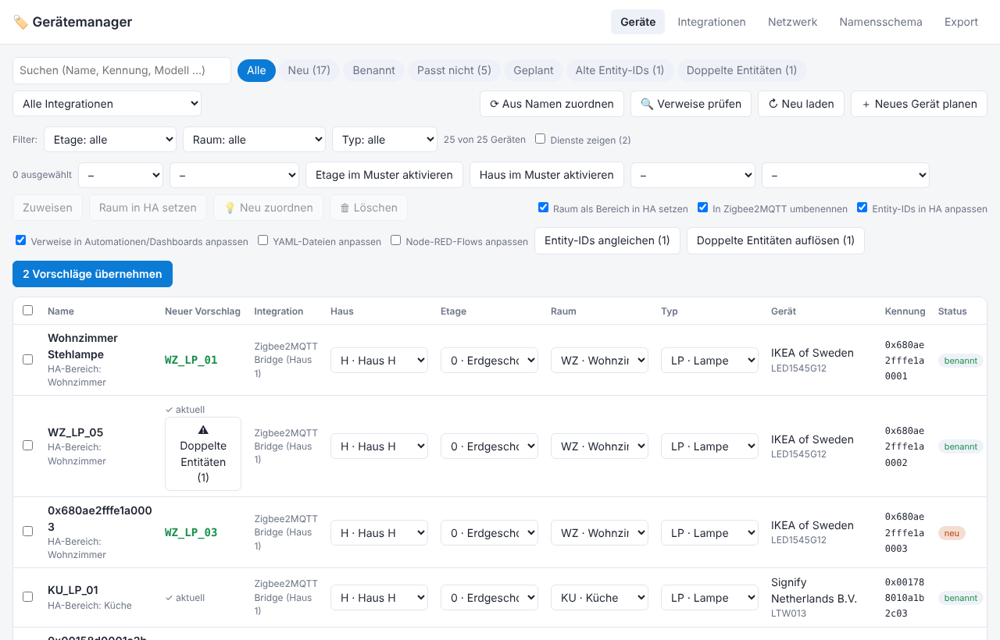
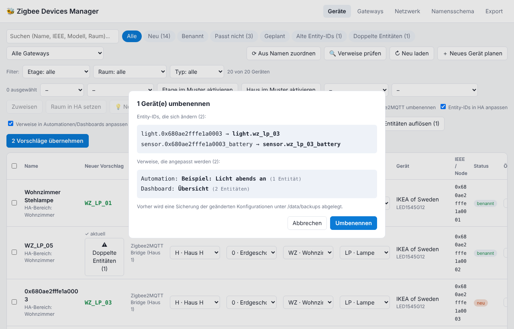
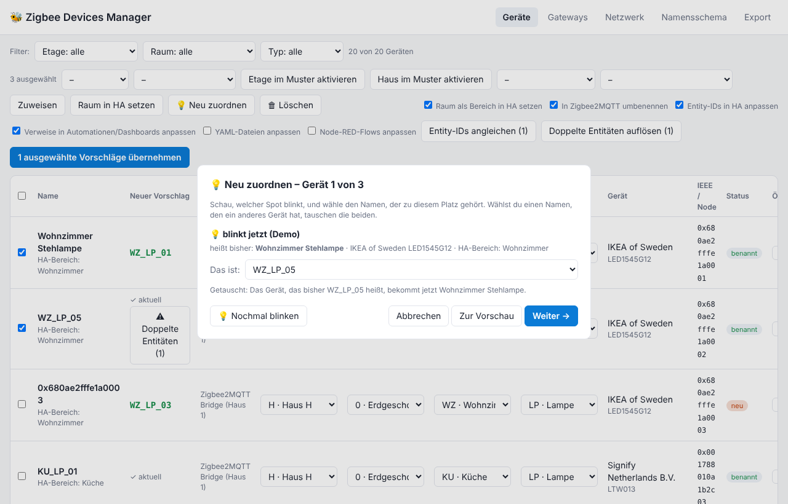
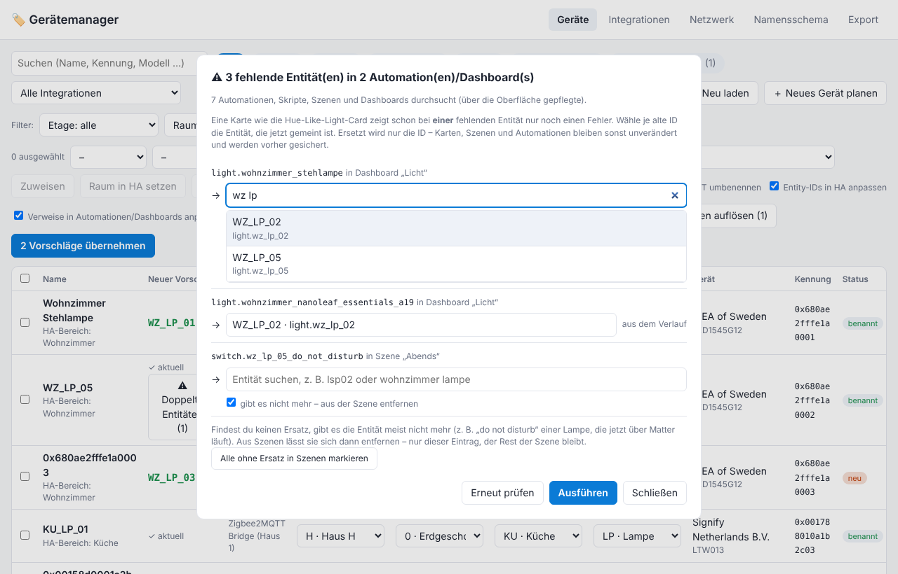
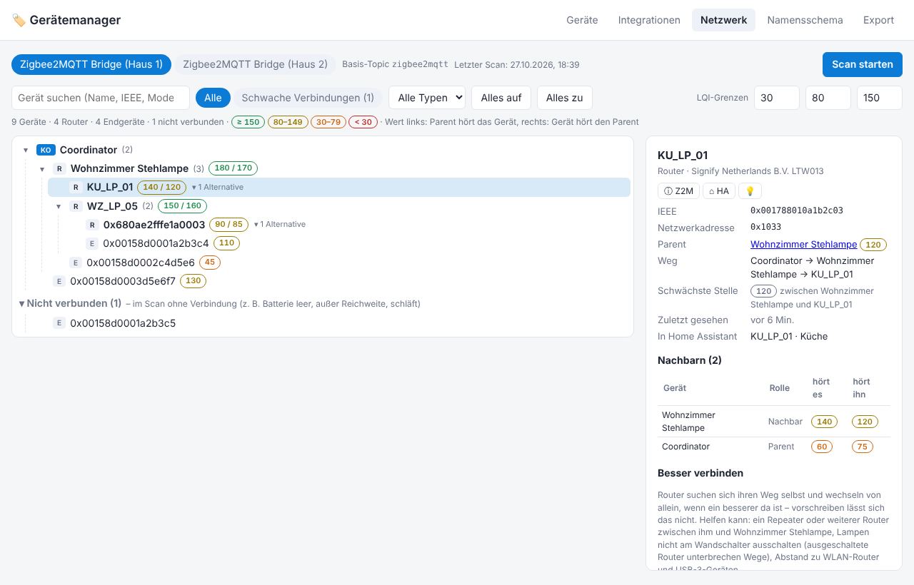
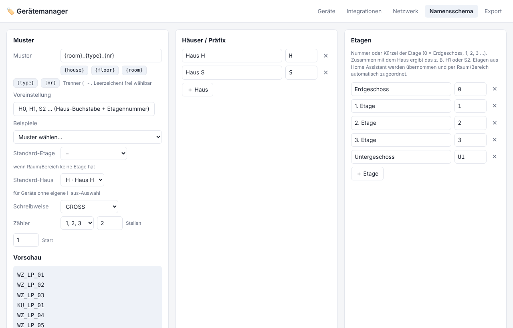
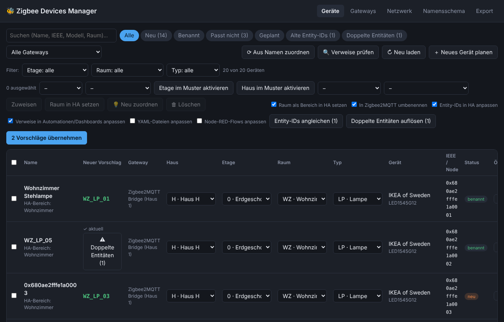

<p align="center">
  
</p>

<h1 align="center">Gerätemanager (Device Manager)</h1>

<p align="center">
  Home Assistant add-on that names all devices – Zigbee, Matter, Shelly and any other integration – after a fixed naming scheme,<br>
  including entity IDs, rooms, automations, scenes and dashboards. (Formerly “Zigbee Devices Manager”.)
</p>

<p align="center">
  <a href="zigbee_devices_manager/CHANGELOG.md"></a>
  <a href="https://github.com/BuRnEd4AiM/Zigbee-Devices-Manager/releases"></a>
  <a href="https://burned4aim.github.io/Zigbee-Devices-Manager/"></a>
  <a href="https://github.com/BuRnEd4AiM/Zigbee-Devices-Manager/actions/workflows/tests.yml"></a>
  <a href="LICENSE"></a>
  
</p>

<p align="center">
  <a href="https://my.home-assistant.io/redirect/supervisor_add_addon_repository/?repository_url=https%3A%2F%2Fgithub.com%2FBuRnEd4AiM%2FZigbee-Devices-Manager"></a>
</p>

<p align="center"><a href="README.md">Deutsch</a> · <b>English</b></p>



> The user interface is in German.

## What it does

- 🏷️ **A naming scheme instead of chaos** – e.g. `{house}{floor}-{room}-{type}{nr}` → `S2-WZEL-LSP03`, with abbreviations, automatic counting and free numbers.
- 🔗 **Everything follows** – device name in Zigbee2MQTT or Home Assistant, entity IDs, room as HA area and references in automations, scripts, scenes, dashboards, YAML and Node-RED. Preview first, verification afterwards.
- 📡 **All devices in one list** – Zigbee2MQTT (also several instances), ZHA, Matter, Shelly, ESPHome and any other integration, filterable by integration; also several houses.
- 💡 **Reassign swapped spots** – lamps blink one after another, you pick the right position; names and entity IDs swap without taking a spot out of the ceiling.
- 🔍 **Clean up** – align old entity IDs, resolve duplicate entities, find and repair broken references (e.g. cards that only show an error).
- 🕸️ **Network view** – the Zigbee network as a tree with link quality.
- 🛟 **Safe** – automatic backups, one-click restore, verification after every change.

## Screenshots

<table>
  <tr>
    <td width="50%"><br><sub><b>Rename with preview</b> – new entity IDs and the automations/dashboards that are updated too.</sub></td>
    <td width="50%"><br><sub><b>💡 Reassign</b> – the device blinks, you pick the name of its position.</sub></td>
  </tr>
  <tr>
    <td><br><sub><b>🔍 Check references</b> – find missing entities, replace them via search or remove them from scenes.</sub></td>
    <td><br><sub><b>Network</b> – who hangs on whom, how good the link is, where the weakest spot is.</sub></td>
  </tr>
  <tr>
    <td><br><sub><b>Naming scheme</b> – pattern, houses, floors, rooms and types with abbreviations.</sub></td>
    <td><br><sub><b>Dark theme</b> – follows the device setting automatically.</sub></td>
  </tr>
</table>

## Try it

- **[▶ Demo in the browser](https://burned4aim.github.io/Zigbee-Devices-Manager/)** – runs without Home Assistant on sample data; changes stay in your browser only.
- **[⬇️ Download the demo](https://github.com/BuRnEd4AiM/Zigbee-Devices-Manager/releases/download/demo/zigbee-devices-manager-demo.html)** – a single HTML file that works offline.

## Installation

1. Click **"Add repository to my Home Assistant"** above – or in Home Assistant: *Settings → Add-ons → Add-on Store → ⋮ → Repositories* and add `https://github.com/BuRnEd4AiM/Zigbee-Devices-Manager`.
2. Install and start **"Gerätemanager"**.
3. **"Gerätemanager"** appears in the sidebar.

If you installed it as "Zigbee Devices Manager", the next update brings the new name – settings, assignments and backups stay.

## Quick start

1. Pick a **naming scheme** ("Namensschema" tab) – e.g. "H0, H1, S2 …" for house letter + floor. Rooms and floors from Home Assistant are imported.
2. In the **device list**, assign house, floor, room and type – one by one or for several devices at once. "⟳ Aus Namen zuordnen" recognises existing names.
3. **"Vorschläge übernehmen"** (apply suggestions) – the preview shows new names, entity IDs and affected automations/dashboards; afterwards the add-on verifies the result.
4. Now and then use **"🔍 Verweise prüfen"** and the **"Alte Entity-IDs"** / **"Doppelte Entitäten"** filters to clean up leftovers.

## Features in detail

<details>
<summary><b>Device list, filters and naming scheme</b></summary>

- List of all devices from Home Assistant (*Settings → Devices & services → Devices*), grouped by integration or gateway; the identifier is the IEEE (Zigbee), node ID (Matter) or MAC address (Wi-Fi/LAN, e.g. Shelly). Services such as sun or weather forecast are hidden ("Dienste zeigen" shows them), devices disabled in HA are marked.
- **One device, one row:** if a device appears in HA through several integrations (e.g. a tablet via the Mobile App and Fully Kiosk Browser) under the same name, it is listed once – expandable, with the filter "Mehrfach eingetragen". Name, room and type apply to all entries. Entries with different names can be joined with "🔗 Zusammenfassen".
- Inline rename, search, filters "new", "named", "doesn't fit", "planned"; plus filters by house, floor, room and type (with counts, "ohne Raum/Typ" finds gaps). Bulk actions only affect the visible devices.
- **Configurable naming scheme**, e.g. `{room}_{type}_{nr}` → `WZ_LP_01`
  - Abbreviations for rooms and device types (sorted alphabetically by name)
  - Automatic counter per room+type that skips names already in use
  - Counter as Arabic (`01`), Roman (`III`) or letters (`C`)
  - UPPER / lower / as typed
- **Floors:** token `{floor}` (e.g. H0 = ground floor, H1 = 1st floor … or S2/S3). Floors from Home Assistant are imported; a device's floor follows its room/HA area but can be overridden.
- **House letter + floor (H0, H1, S2 …):** pattern `{house}{floor}-{room}-{type}{nr}` → `H1-wzfl-lband01`, `S2-wzfl-lband01`; one-click preset in the scheme tab; a house can be set per gateway.
- **Rooms from Home Assistant:** all HA areas are imported as rooms (abbreviation suggested and editable); devices get their HA area preselected.
- **Recognise existing names:** the add-on splits names by your pattern and abbreviations (e.g. `H1-WZFL-KON03` → house/floor H1, room WZFL, type KON, no. 03). A fitting name stays as it is including its number ("✓ aktuell"); new numbers only fill free slots.
- **House/floor in the name takes precedence**, and rooms are only chosen when their code fits (an area "Bad (H1)" is never assigned to an S2 device).
- Planned devices reserve names/numbers. CSV/JSON export, scheme export/import.
</details>

<details>
<summary><b>Renaming: Zigbee2MQTT, ZHA, Matter, Shelly …</b></summary>

- **Zigbee2MQTT:** renamed like Z2M's own dialog (friendly name, MQTT topic and – with "Entity-IDs in HA anpassen" – entity IDs, `homeassistant_rename`). The add-on waits for Z2M's reply and for Home Assistant to pick up the device again, then updates HA (old custom name removed, area set last).
- **Several Zigbee2MQTT instances:** the add-on asks MQTT (`<base>/bridge/devices`) which instance the device really belongs to and detects base topics itself (`<base>/bridge/info`).
- **ZHA, Matter and every other integration** (Shelly, ESPHome, Tasmota …): renamed in Home Assistant's device registry (`name_by_user`), including entity IDs, references and area. Matter devices are listed under the "Matter" gateway with their node ID; pairing still happens in the Home Assistant app.
- **Set the room in Home Assistant** ("Raum als Bereich in HA setzen", default on); missing areas are created. Assigning a room also works without renaming.
- **Independent options:** rename in Zigbee2MQTT, rename entity IDs, update references (default on), YAML files, Node-RED flows.
- **Verification** with ✅/⚠️/❌ for device names (also in Z2M), entity IDs and leftover references; a rename that did not happen is reported explicitly.
</details>

<details>
<summary><b>Cleaning up entity IDs and references</b></summary>

- **Entity IDs with the area in front:** Home Assistant creates new entity IDs as `<area>_<device>_<entity>` (`light.wohnzimmer_s2_wzel03`). The add-on recognises that prefix (also a former area); for Zigbee2MQTT it reads the suffix from the unique ID – result: `light.s2_wzel_lsp03`.
- **"Alte Entity-IDs" / "⚠ Entity-IDs angleichen":** named devices whose entity IDs still carry the pairing name; renames only the IDs.
- **"Doppelte Entitäten":** if the correct ID already exists (a leftover from a former name), both are shown with their state (active/orphaned/disabled) and usage. Orphaned or disabled leftovers can be removed, references are switched; active entities are never removed.
- **"🔍 Verweise prüfen":** finds automations, scripts, scenes and dashboards with entities that no longer exist. Replace via a search field (name/ID, several words), suggestions from the log of all renames; entities that no longer exist can be removed from scenes. Only the ID is replaced, a backup is made first.
- **Update references:** uses the entity IDs Home Assistant actually has after renaming. UI-managed automations, scripts, scenes and dashboards, optionally **YAML files** under `/config` and **Node-RED flows**. `.storage`, `custom_components` and `secrets.yaml` are never touched.
</details>

<details>
<summary><b>💡 Blink and reassign (swapped spots)</b></summary>

- **"💡" per device** makes it blink – identify button (Matter, ZHA), the Zigbee2MQTT "blink" effect (does not change the state), or a short flash of the lamp.
- **"💡 Neu zuordnen":** select devices (e.g. via the room + type filters). They blink one after another and you pick the name of each position; choosing a name another device has swaps the two (swap or rotation).
- Device name, Zigbee2MQTT name, entity IDs, house/floor/room/type and the area follow the name – also between Matter and Zigbee. **Automations, scenes and dashboards stay unchanged** and then control the right position. If the other device lacks an entity (e.g. Matter ↔ Zigbee), the preview warns.
- Uses temporary names, with preview, backup and verification; if the first step fails it is rolled back.
</details>

<details>
<summary><b>Integrations, pairing, deleting</b></summary>

- **"Integrationen" tab:** every Zigbee2MQTT instance, ZHA, Matter and every other integration with label, house (applies to all its devices) and – for Zigbee2MQTT – MQTT base topic. "4 Min anlernen" opens the network for pairing, with countdown.
- **Jump to a device:** "ⓘ Z2M" opens it in the Zigbee2MQTT UI, "⌂ HA" opens the device page in Home Assistant.
- **Delete devices completely:** Zigbee2MQTT devices leave the network and are removed from Z2M, ZHA devices via `zha.remove`, Matter devices are removed from Home Assistant's Matter fabric. Nothing happens until you type **LÖSCHEN**. The ZHA coordinator is protected. Devices of other integrations are not deleted by the add-on – remove them in Home Assistant from their integration.
</details>

<details>
<summary><b>Network (Zigbee2MQTT)</b></summary>

- The network as a collapsible tree – who hangs on whom and how good the link is (LQI green ≥ 150, yellow 80–149, orange 30–79, red < 30; thresholds adjustable).
- Routers hang on the best path to the coordinator, end devices on their parent; routers in range can be expanded; devices without a link are grouped under "Nicht verbunden".
- Search, weak-link and device-type filters, instance switcher, details on click. "Scan starten" requests the network map on demand; every map Zigbee2MQTT sends is picked up automatically. **Better connection:** re-pair an end device via a chosen router.
</details>

<details>
<summary><b>Backups</b></summary>

- Naming scheme, assignments, planned devices, gateways and the device list are backed up – after changes at most hourly, daily and before every rename, area assignment, swap, delete and restore (the last 60 are kept).
- Location: `/config/zigbee_devices_manager/backups` – survives reinstalling the add-on and is part of every HA backup. Missing settings are restored automatically at start.
- "Export" tab: list of backups, back up now, restore, download as JSON or the device list as CSV, restore from a file.
</details>

## Versions

Changes per version are listed in the **[changelog](zigbee_devices_manager/CHANGELOG.md)** (German) – Home Assistant shows the same text in the update dialog. Every version also has a **[release](https://github.com/BuRnEd4AiM/Zigbee-Devices-Manager/releases)** with the demo for download.

## Development

```sh
cd zigbee_devices_manager && python3 server.py          # without HA the UI falls back to demo mode
python3 -m unittest discover -s test                    # tests (renaming, entity IDs, references, swapping)
node --test test/zigbee-tree.test.mjs                   # tests of the network tab
python3 scripts/build_demo.py                           # rebuild the demo
node scripts/screenshots.js                             # images for this page (needs Playwright)
```

- After code changes the `version` in `zigbee_devices_manager/config.yaml` must go up, otherwise Home Assistant offers no update. Every version needs a `## <version>` section in `zigbee_devices_manager/CHANGELOG.md`; merging creates the release `vX.Y.Z` from it automatically.
- The browser demo is published via GitHub Pages on every merge (enable once: *Settings → Pages → Source: GitHub Actions*).
